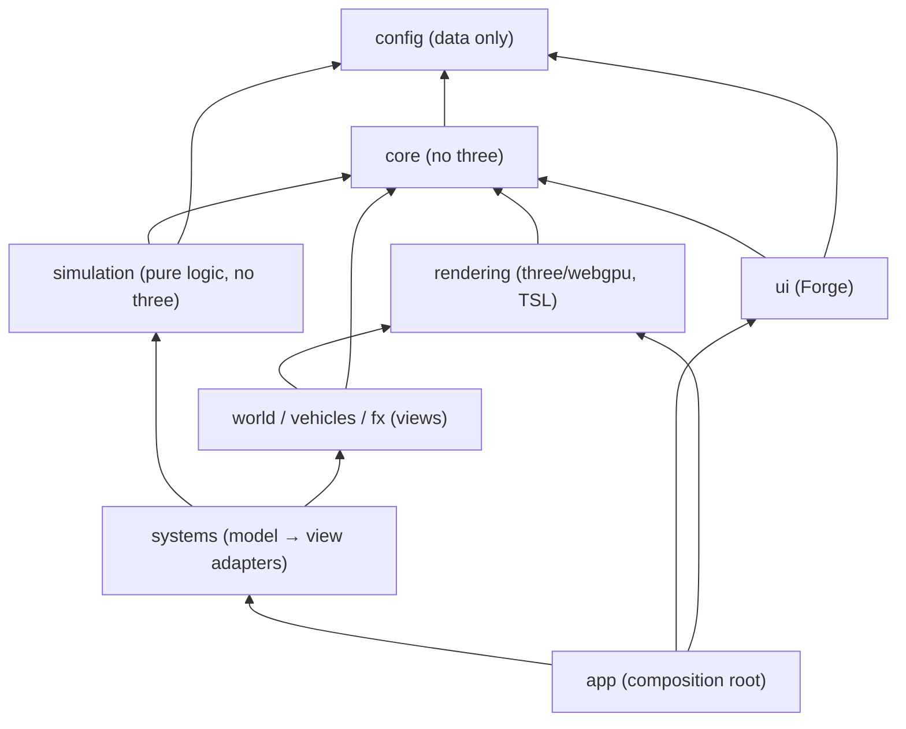

# Pixel Street — загальний план

Нескінченна процедурна мініатюрна вулиця в піксельній стилістиці: жовте таксі їде повз крамниці, будинки й провулки; мокрий асфальт, калюжі з брижами та бризками від шин, сліди шин, що згасають, листя, яке розлітається від таксі, вигнутий світ («мініатюрна планета»). Погода: **Sunny / Rain / Downpour / Golden Hour / Sunset Evening** з плавними переходами. Таксі зупиняється на автобусних зупинках, чекає й їде далі. Усе керується бічною панеллю **Forge**.

> Етапи 1–9 зроблено (стан і подробиці — [`PROJECT_STATUS.md`](./PROJECT_STATUS.md)). Лишився Етап 10 — перевірка й підсумок (нижче).

## Погоджені рішення

| Питання | Рішення |
|---|---|
| Стек | Vanilla three.js (`three/webgpu`, TSL), Vite, чистий JS ES2022 з JSDoc, без React і TypeScript |
| Без WebGPU | Без запасного режиму на WebGL: екран «WebGPU not supported» |
| Графіка | 100 % процедурно: low-poly геометрія + піксельні текстури з `<canvas>` |
| Forge | Бічна панель на `lil-gui` (праворуч, на телефоні згорнута), будується зі схеми `params.schema.js` |
| Мова UI | English |
| Камера | Завжди на таксі, межі ракурсу не показують краю світу (`CameraRig`) |

## Шари й напрям залежностей

- «A → B»: A може імпортувати B; зворотні імпорти заборонені й перевіряються ESLint (`no-restricted-imports`): `core/` і `simulation/` не імпортують `three`, `ui/` не імпортує `systems/`.
- **Forge не чіпає меші й уніформи**: він змінює лише `Store`. Системи підписані на свої ключі й самі оновлюють уніформи чи перебудовують геометрію; пресети, URL-параметри й Forge працюють через той самий механізм.
- `params.schema.js` — єдине джерело правди: дефолти, межі, крок, варіанти списків, валідація імпорту. Новий параметр додається в одному місці; тест «жодного мертвого контролу» перевіряє, що його хтось читає.
- `WorldUniforms` створюється в `App` і передається залежностям; глобальних змінних на рівні модуля немає.
- Системи наслідують `System`: готові після конструктора, далі `update(dt, frame)` без алокацій і `dispose()`; ресурси — через `track()`.

## Конвенції коду

- Класи — `PascalCase.js`, утиліти — `camelCase.js`. Одиниці: метри, секунди, радіани.
- У гарячому циклі жодних `new Vector3()`: тимчасові об'єкти переюзуються.
- JSDoc для публічних API. Prettier форматує, ESLint (`@eslint/js` + `eslint-plugin-import` + межі шарів) перевіряє.
- Коміти — Conventional Commits (`feat(taxi): bus stop state machine`).

## Продуктивність

1. Кадр упирається у фрагментний шейдинг (виміри — `PROJECT_STATUS.md`, «Продуктивність»), тож головні важелі — роздільність (регулятор якості) і вартість матеріалів, а не геометрія.
2. Будинки чанка — один меш, що будується один раз на петлю (кеш), дрібниці — `InstancedMesh`.
3. Частинки анімуються на GPU (compute / vertex), без щокадрових завантажень буферів.
4. Жодних точкових джерел світла: emissive і фейкові плями світла; одне тіньове світло з каскадами.
5. Короткий draw distance, який маскують вигин і туман.
6. Нуль алокацій у циклі кадру.
7. Рівень пристрою на старті й адаптивний регулятор роздільності на льоту.

## Не зроблено з етапів 1–9

- Відбиття `real` у калюжах (`reflector()` у ¼ роздільності): у схемі лише `off` / `fake`.
- Кільця на сухому асфальті там, де падають краплі бризок.
- Окремі спалахи-«блискавки» геометрією (є лише спалах світла).

## Етап 10 — перевірка й підсумок

### Автоматично
- `npm run lint` — 0 помилок, включно з межами шарів.
- `npm run build` — без помилок і попереджень про відсутні експорти TSL.
- `npm test` (Vitest, Node) — шари `core/`, `simulation/`, план вулиці й правила будинків, межі камери.
- `npm run audit`, `npm run geometry -- overlaps`, `npm run perf`.
- Браузер: `?preset=sunny|rain|downpour|golden|sunset&forge=1` — знімок кожного пресета, `window.__street` (FPS, стан таксі, draw calls) і консоль без помилок WebGPU; `node scripts/shots.js --bounds` — крайні ракурси камери.

### Вручну
1. `npm run dev`, Chrome/Edge: вулиця нескінченна, без стрибків на межах чанків і на шві петлі.
2. Таксі зупиняється біля кожної зупинки, чекає й рушає; з вимкненим `stop at bus stops` проїжджає мимо.
3. Усі пресети погоди: переходи плавні; у дощ калюжі, брижі й мокрі сліди, на сонці асфальт висихає.
4. В'їзд у калюжу: бризки, кільця, мокрі сліди, що згасають.
5. Листя злітає за таксі й кружляє на вітрі.
6. **Телефон:** `npm run dev:mobile`, `https://<IP-ПК>:5173` (прийняти сертифікат): FPS з лічильником, рівень пристрою й регулятор якості, Forge зручно керується пальцем.
